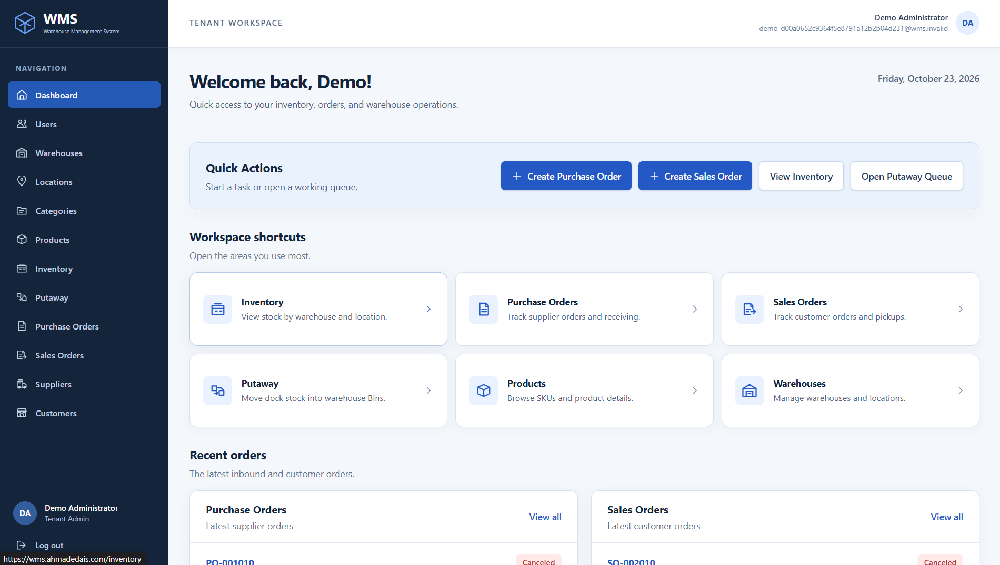
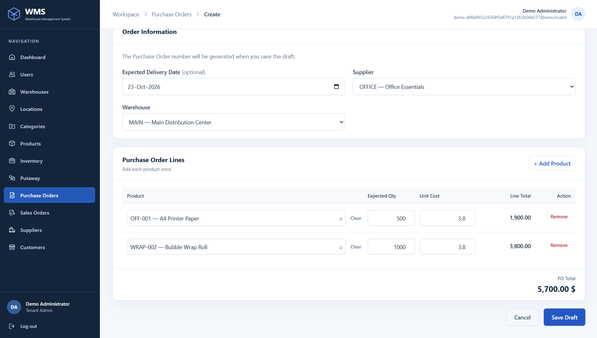
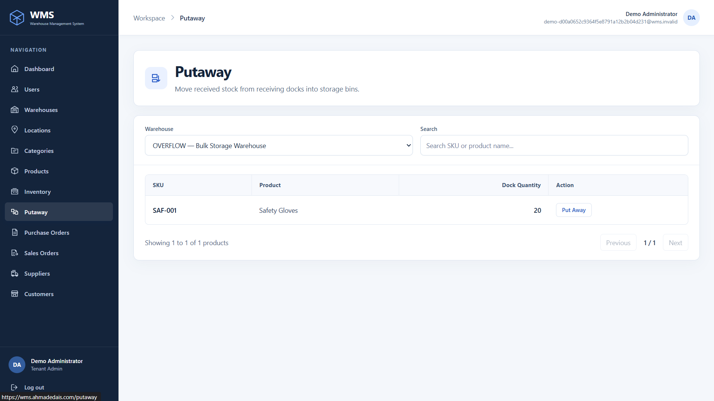
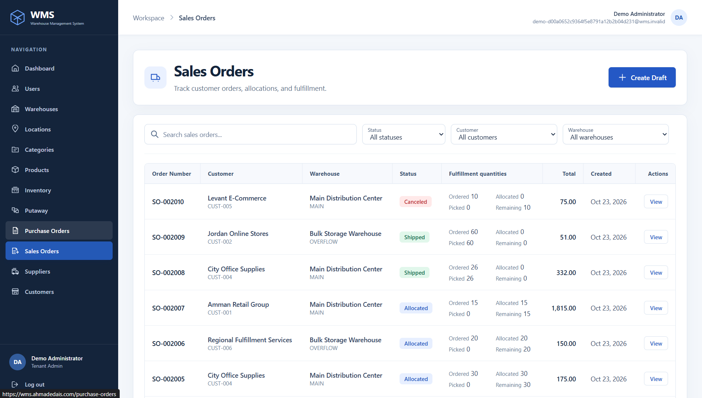

# Multi-Tenant Warehouse Management System

A full-stack warehouse management application built with **ASP.NET Core, Angular, and SQL Server**. It connects catalog and warehouse setup to purchasing, receiving, putaway, inventory, and customer order fulfillment. Each company works in its own tenant workspace, while a separate platform administrator provisions tenants.

This independently developed portfolio project demonstrates API design, relational data modeling, role-based access control, stateful warehouse workflows, and container deployment.

**Live application:** [wms.ahmadedais.com](https://wms.ahmadedais.com)

Visitors can select **Try Live Demo** on the landing or login page to request a temporary workspace with sample warehouses, products, inventory, and orders. Demo creation is controlled by server configuration and may be unavailable.

## Screenshots

| Dashboard | Create a purchase order |
| :---: | :---: |
|  |  |
| **Putaway queue** | **Sales orders** |
|  |  |

## What it does

WMS gives tenant staff a shared view of warehouse stock and the orders that change it. A manager can create a purchase order; an operator can receive its goods at a receiving dock and put them away in bins. Available bin stock can then be reserved for a sales order, and confirmed pickups update inventory and order status. The Angular application provides management pages, operational dialogs, inventory views, and a dashboard with recent orders and links appropriate to the signed-in role.

## Key features

| Area | Implemented capabilities |
| --- | --- |
| Tenant and user administration | Platform tenant provisioning, suspension and reactivation; tenant user creation, role assignment, account status, and self-service password changes. |
| Warehouse and catalog setup | Warehouses; hierarchical locations and categories; products with multiple categories; supplier and customer records with active/inactive lifecycle controls. |
| Inventory | Stock per product and location, with on-hand, allocated, and available quantities; tenant stock summaries, product/location drilldowns, and low-stock indicators based on reorder points. |
| Inbound | Draft purchase orders, approval and cancellation, partial receiving into a warehouse's receiving dock, and putaway from that dock to one or more bins. Receipts and transfers record stock movements. |
| Outbound | Draft sales orders, availability checks, approval with full bin-stock allocation, cancellation with reservation release, and partial or complete pickup confirmation. Pickup reduces on-hand and allocated stock, records shipment movements, and completes the order when all quantities are fulfilled. |
| Access and demo | JWT sign-in, refresh and logout; server-enforced role policies; optional guest demo provisioning with seeded data and expiry cleanup. |

## Roles and permissions

The API enforces permissions; frontend route guards and controls reflect those permissions for navigation.

| Role | Current scope |
| --- | --- |
| `SystemAdmin` | Provisions and manages tenants. Tenant warehouse operations are outside this role's API policies. |
| `TenantAdmin` | Manages tenant users, warehouses, locations, catalog and partners, and can perform inbound and outbound workflows. |
| `WarehouseManager` | Across the tenant, manages catalog and partners, purchase and sales orders, receiving, putaway, and pickup. Does not manage tenant users or warehouse/location settings. |
| `WarehouseOperator` | Across the tenant, views relevant catalog and orders; receives purchases, puts stock away, and confirms sales order pickups. |
| `Analyst` | Read-only access to inventory summaries and relevant catalog and order data. |

## Technology stack

| Layer | Technologies in this repository |
| --- | --- |
| Frontend | Angular 22, TypeScript 6, Tailwind CSS 4, Angular Signals, Reactive Forms, Router, and RxJS. |
| Backend | .NET 8 / ASP.NET Core Web API, C#, EF Core 8, MediatR 14, FluentValidation 12, JWT bearer authentication, BCrypt, and Swagger/OpenAPI in Development. |
| Database | Microsoft SQL Server, a SQL Server Database Project (`.sqlproj`) published as a DACPAC, EF Core mappings, and a stored procedure for expired demo-tenant cleanup. |
| Deployment | Docker images for the API and Angular/Caddy frontend, Docker Compose with SQL Server 2022 for local deployment, and Caddy configurations for local and public HTTPS hosting. |

## Architecture

The backend is a layered ASP.NET Core application organized around Domain, Application, Infrastructure, and API projects.

```text
Angular UI ──HTTP──> WMS.API ──MediatR──> WMS.Application ──> WMS.Domain
                         │                      │
                         └──> WMS.Infrastructure ┘
                                      │
                                  SQL Server
```

| Project | Responsibility |
| --- | --- |
| [`WMS.Domain`](WMS-Backend/WMS.Domain/) | Entities, status values, and business state changes. |
| [`WMS.Application`](WMS-Backend/WMS.Application/) | Feature commands and queries, handlers, interfaces, and FluentValidation rules. A MediatR pipeline runs validators before handlers. |
| [`WMS.Infrastructure`](WMS-Backend/WMS.Infrastructure/) | EF Core/SQL Server mappings, tenant context, authentication services, and demo data support. |
| [`WMS.API`](WMS-Backend/WMS.API/) | HTTP controllers, authorization policies, middleware, configuration, and health endpoints. |

The [SQL Database Project](WMS-Backend/WMS.DatabaseProject/) defines the schema. EF Core maps to that schema; EF migrations are not used. The [Angular application](WMS-Frontend/) is organized by feature, with HTTP services, route guards, Signals for page state, RxJS for asynchronous requests, and Reactive Forms for data entry.

## Technical highlights

- **Tenant isolation:** Tenant-owned entities carry `TenantId`. EF Core applies a tenant query filter using the authenticated tenant context, and a save interceptor stamps tenant ownership on new records. Platform-only operations use an explicit system context and separate role policies.
- **Session-aware authentication:** The API issues short-lived JWT access tokens and rotating refresh tokens tied to database sessions. The browser keeps the access token in memory; the refresh token is sent in a Secure, HttpOnly, SameSite=Strict cookie. Protected requests validate session, user, and tenant status, and logout revokes the session.
- **Server-side authorization:** Controller policies distinguish platform administration, tenant management, read access, receiving, putaway, and pickup. UI visibility does not grant API access.
- **Inventory consistency:** Receiving, putaway, allocation, cancellation, and pickup validate order state, location, tenant ownership, and quantities before saving related stock and order changes. SQL constraints and EF row-version checks provide further protection against invalid or conflicting writes.
- **Schema-first data model:** The database project defines foreign keys, checks, and tenant-scoped unique values for records such as product SKUs, partner codes, stock locations, and order numbers. The DACPAC post-deployment script seeds the five supported roles.
- **CQRS and validation:** MediatR dispatches feature-specific read queries and mutation commands. FluentValidation runs in a shared pipeline, while domain methods enforce state transitions such as draft-only editing and full sales-order allocation.
- **Deployment and demo boundaries:** Docker packages the API and frontend; Caddy serves the Angular build and proxies API requests. Production startup validates required settings, while the optional demo provisions an expiring tenant with sample data and cleans up expired demo tenants through a SQL stored procedure.

## Getting started

### Local development: ASP.NET Core and Angular

You need the .NET 8 SDK, Node.js and npm compatible with the checked-in Angular 22 project, and a reachable SQL Server database. The frontend Dockerfile uses Node 24, and [`package.json`](WMS-Frontend/package.json) specifies npm 11. Build and publish the [`WMS.DatabaseProject.sqlproj`](WMS-Backend/WMS.DatabaseProject/WMS.DatabaseProject.sqlproj) DACPAC with Visual Studio/SSDT on Windows before starting the API. Its post-deployment script creates the five roles. Create a SQL login with the database access needed by the API; see the [local Docker guide](DOCKER_LOCAL_DEPLOYMENT.md) for a concrete example. Do not use EF migrations.

From the repository root, set the API's local connection string and JWT signing secret in the `WMS.API` project's .NET User Secrets. The frontend development setup below uses HTTPS, so allow its origin as well:

```powershell
dotnet user-secrets set "ConnectionStrings:WmsConnection" "<local SQL Server connection string>" --project WMS-Backend/WMS.API
dotnet user-secrets set "JwtSettings:Secret" "<random secret of at least 32 UTF-8 bytes>" --project WMS-Backend/WMS.API
dotnet user-secrets set "Frontend:AllowedOrigins:0" "https://localhost:4200" --project WMS-Backend/WMS.API
dotnet dev-certs https --trust
dotnet run --project WMS-Backend/WMS.API --launch-profile https
```

The API's HTTPS launch profile listens at `https://localhost:7105`; Swagger UI is available at `/swagger` in Development. In another terminal:

```powershell
cd WMS-Frontend
npm ci
npm start -- --ssl
```

Open `https://localhost:4200` and accept the local frontend development certificate if prompted. Both browser origins use HTTPS so the session refresh cookie can be sent. The Angular development environment points to `https://localhost:7105/api/v1`.

For an empty database, provision the first `SystemAdmin` once with [`WMS.BootstrapAdmin`](WMS-Backend/WMS.BootstrapAdmin/). It reads `ConnectionStrings__WmsConnection` from its process environment and prompts interactively for the account details; it does not accept a password on the command line. After setting that environment variable privately, run `dotnet run --project WMS-Backend/WMS.BootstrapAdmin`. A SystemAdmin can then provision a tenant and its initial TenantAdmin.

### Local Docker deployment

The root [`compose.yaml`](compose.yaml) starts SQL Server 2022 Express, the API, and Caddy. Copy [`.env.example`](.env.example) to a private `.env` if one does not exist, then fill the SQL, JWT, host, and frontend-origin settings described in the [local Docker deployment guide](DOCKER_LOCAL_DEPLOYMENT.md). The Compose build does **not** deploy the database schema or create the application SQL login.

```powershell
docker compose config --quiet
docker compose build api caddy
docker compose up -d sqlserver
```

Publish the DACPAC to the Compose SQL Server, create the `wms_app` login and database user, then start the remaining services:

```powershell
docker compose up -d api caddy
docker compose exec api dotnet /maintenance/WMS.BootstrapAdmin.dll
```

Run the bootstrap command only for a new database, in an interactive terminal. Follow the [local Docker deployment guide](DOCKER_LOCAL_DEPLOYMENT.md) for the exact DACPAC, SQL login, `wms.local.test` hosts entry, and local HTTPS certificate steps. The local Compose file binds Caddy to loopback; [`Caddyfile.production`](WMS-Frontend/Caddyfile.production) is a separate public-host configuration for HTTPS deployment.

## Current limits

- There is no warehouse-assignment model for limiting managers or operators to particular warehouses.
- Confirming a sales order pickup also records the stock leaving the warehouse. Separate packing, carrier handoff, and shipping screens are not implemented.
- Low-stock conditions appear in inventory views; push alerts and a general stock-adjustment workflow are not implemented.
- The repository has frontend unit-test tooling, but no broad automated API or cross-layer integration test suite. Builds and manual workflow checks remain important.

## Author

**Ahmad Khadar Edais** · [Portfolio](https://ahmadedais.com) · [GitHub](https://github.com/AhmadEdais) · [LinkedIn](https://www.linkedin.com/in/ahmad-edais/)
